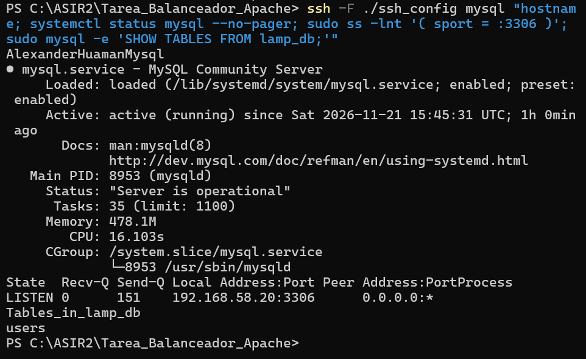
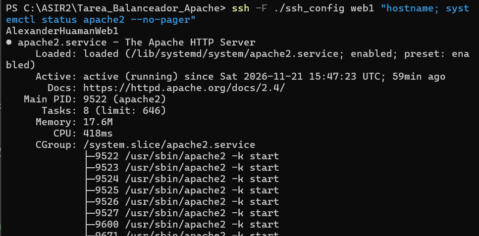
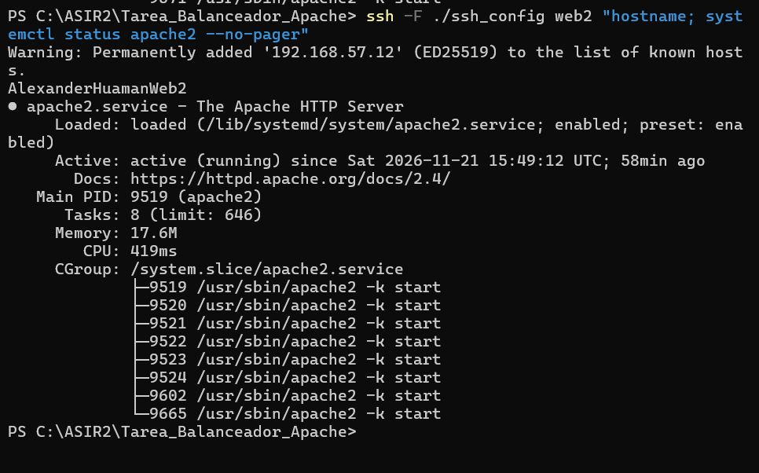
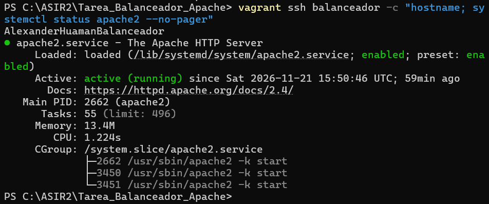

# Infraestructura web en tres niveles con máquinas virtuales

## Datos de la práctica

- **Nombre y apellidos:** Alexander Manuel Huaman Linares
- **Grupo:** ASIR 2
- **Módulo:** Implantación de Aplicaciones Web
- **Fecha:** 20/11/2026

## Índice

1. [Introducción y preparación del proyecto](#introduccion)
2. [Diseño de la red](#diseno-de-la-red)
3. [Creación y aprovisionamiento de las máquinas](#aprovisionamiento)
4. [Configuración de MySQL y despliegue de la aplicación](#mysql-y-aplicacion)
5. [Configuración del balanceador Apache](#balanceador)
6. [Listas de control de acceso y reglas por máquina](#control-de-acceso)
7. [Pruebas de funcionamiento en local](#pruebas)
8. [Publicación del balanceador y configuración de HTTPS](#publicacion-y-https)
9. [Grabación y entrega](#grabacion-y-entrega)
10. [Incidencias](#incidencias)
11. [Fuentes de consulta](#fuentes)
<a id="introduccion"></a>

## 1. Introducción y preparación del proyecto

En esta práctica monté una aplicación de gestión de usuarios en cuatro máquinas virtuales con Vagrant y VirtualBox. Una máquina hace de balanceador, otras dos tienen Apache y la cuarta guarda los datos en MySQL. Cuando abro la página, el balanceador manda la petición a uno de los Apache. Los dos usan la misma base de datos.

Usé la aplicación PHP, el archivo SQL y los scripts de la práctica de dos niveles. Adapté los scripts para que la aplicación funcionara en los dos Apache y añadí el balanceador.

### 1.1. Comprobación de las herramientas

Antes de crear las máquinas comprobé que tenía Vagrant y VirtualBox instalados.

Desde PowerShell ejecuté:

```powershell
vagrant --version
VBoxManage.exe --version
```

El primer comando mostró que tenía Vagrant 2.4.9. El segundo mostró la versión de VirtualBox, que en mi caso era la 7.2.4.

### 1.2. Creación de la carpeta y del Vagrantfile

Primero preparé una carpeta para guardar los archivos de la práctica.

Abrí PowerShell y ejecuté estos comandos.

```powershell
cd C:\ASIR2
mkdir Tarea_Balanceador_Apache
cd Tarea_Balanceador_Apache
```

En la práctica anterior había creado el Vagrantfile con este comando.

```powershell
vagrant init debian/bookworm64
```

El comando crea un archivo llamado `Vagrantfile` con la imagen `debian/bookworm64`, que corresponde a Debian 12.

Para esta práctica usé como base el archivo anterior y lo adapté a las cuatro máquinas. En el apartado 3.1 está el Vagrantfile completo.

### 1.3. Preparación de los archivos

Separé los scripts, las capturas y el vídeo en tres carpetas.

```powershell
mkdir scripts
mkdir images
mkdir screencast
```

Después copié la carpeta `recursos` y los scripts de MySQL y Apache de la práctica anterior.

```powershell
Copy-Item -LiteralPath ..\Tarea_Pila_Lamp\recursos -Destination .\recursos -Recurse
Copy-Item -LiteralPath ..\Tarea_Pila_Lamp\scripts\mysql.sh -Destination .\scripts
Copy-Item -LiteralPath ..\Tarea_Pila_Lamp\scripts\apache.sh -Destination .\scripts
```

El SQL de la tabla `users` quedó en `recursos\db`. Los archivos PHP y el formulario HTML quedaron en `recursos\src`.

Adapté `mysql.sh` para dar acceso a los dos Apache y `apache.sh` para instalar la aplicación en ambos. Después creé los archivos que faltaban.

```powershell
New-Item -ItemType File -Path .\scripts\balanceador.sh
New-Item -ItemType File -Path .\scripts\firewall.sh
New-Item -ItemType File -Path .\ssh_config
```

En el apartado 3 está el script del balanceador. En el apartado 6 explico el cortafuegos, cómo desconecté el NAT desde el Vagrantfile y cómo entré por SSH.

<a id="diseno-de-la-red"></a>
## 2. Diseño de la red

Preparé dos redes internas. La primera une el balanceador con Web1 y Web2. La segunda une los dos Apache con MySQL.

| Nivel | Máquina en Vagrant | Nombre de la máquina         | IP en la red web | IP en la red de bases de datos |
| ----- | ------------------ | ---------------------------- | ---------------- | ------------------------------ |
| 1     | `balanceador`      | `AlexanderHuamanBalanceador` | `192.168.57.10`  | —                              |
| 2     | `web1`             | `AlexanderHuamanWeb1`        | `192.168.57.11`  | `192.168.58.11`                |
| 2     | `web2`             | `AlexanderHuamanWeb2`        | `192.168.57.12`  | `192.168.58.12`                |
| 3     | `mysql`            | `AlexanderHuamanMysql`       | —                | `192.168.58.20`                |

En VirtualBox, la red web se llama `asir-balanceador-web` y usa `192.168.57.0/24`. La red de bases de datos se llama `asir-balanceador-db` y usa `192.168.58.0/24`.

Usé NAT durante la instalación para que cada máquina descargara sus paquetes. Al terminar, Web1, Web2 y MySQL se quedaron en las redes internas. El balanceador mantuvo el NAT para recibir las conexiones de la web.

Para publicar el balanceador desde casa utilicé la IP pública de mi conexión y un nombre de No-IP. Los reenvíos del router están en el apartado 8.
<a id="aprovisionamiento"></a>
## 3. Creación y aprovisionamiento de las máquinas

### 3.1. Vagrantfile completo

En el [Vagrantfile](./Vagrantfile) puse la imagen de Debian, las IP y los puertos de la tabla anterior. También indiqué qué script tenía que ejecutar Vagrant en cada máquina.

```ruby
require "open3"

Vagrant.configure("2") do |config|
  config.vm.box = "debian/bookworm64"

  red_web = "asir-balanceador-web"
  red_db = "asir-balanceador-db"
  ip_host = ENV.fetch("BALANCEADOR_IP_HOST", "192.168.1.137")
  dominio = ENV.fetch("BALANCEADOR_DOMINIO", "balanceadorweb.ddns.net")
  unless dominio.match?(/\A[a-zA-Z0-9][a-zA-Z0-9.-]*\z/)
    abort "BALANCEADOR_DOMINIO debe contener solo el nombre DNS."
  end

  # Puerto SSH local que Vagrant usa al preparar las maquinas internas.
  config.vm.network "forwarded_port", guest: 22, host: 2222,
    host_ip: "127.0.0.1", id: "ssh", auto_correct: true

  # El SSH de las máquinas privadas pasa por el balanceador después de instalar.
  archivo_ssh = File.join(__dir__, "ssh_config")
  salto_ssh = %(ssh.exe -F "#{archivo_ssh}" -o BatchMode=yes -W %h:%p)

  config.vm.define "mysql" do |mysql|
    # La marca se guarda después de instalar los servicios y aplicar el cortafuegos.
    marca = ".vagrant/machines/mysql/virtualbox/red-privada"
    instalado = File.file?(File.join(__dir__, marca))

    if instalado
      mysql.vm.network "forwarded_port", guest: 22, host: 2222, id: "ssh", disabled: true
      mysql.ssh.host = "192.168.58.20"
      mysql.ssh.port = 22
      mysql.ssh.proxy_command = "#{salto_ssh} web1"
    end

    mysql.vm.hostname = "AlexanderHuamanMysql"
    mysql.vm.network "private_network", ip: "192.168.58.20",
      virtualbox__intnet: red_db
    mysql.vm.provision "shell", path: "scripts/mysql.sh" unless instalado
    mysql.vm.provision "firewall", type: "shell", path: "scripts/firewall.sh", args: ["mysql"]
    unless instalado
      mysql.vm.provision "finalizar", type: "shell", inline: "touch /vagrant/#{marca}"
    end

    mysql.vm.provider "virtualbox" do |vb|
      vb.name = "ASIR-Balanceador-MySQL"
      vb.memory = 1024
      vb.customize ["modifyvm", :id, "--nic1", "null", "--cable-connected1", "off"] if instalado
    end
  end

  config.vm.define "web1" do |web1|
    # La marca se guarda después de instalar los servicios y aplicar el cortafuegos.
    marca = ".vagrant/machines/web1/virtualbox/red-privada"
    instalado = File.file?(File.join(__dir__, marca))

    if instalado
      web1.vm.network "forwarded_port", guest: 22, host: 2222, id: "ssh", disabled: true
      web1.ssh.host = "192.168.57.11"
      web1.ssh.port = 22
      web1.ssh.proxy_command = "#{salto_ssh} balanceador"
    end

    web1.vm.hostname = "AlexanderHuamanWeb1"
    web1.vm.network "private_network", ip: "192.168.57.11",
      virtualbox__intnet: red_web
    web1.vm.network "private_network", ip: "192.168.58.11",
      virtualbox__intnet: red_db
    web1.vm.provision "shell", path: "scripts/apache.sh", args: ["web1"] unless instalado
    web1.vm.provision "firewall", type: "shell", path: "scripts/firewall.sh", args: ["web1"]
    unless instalado
      web1.vm.provision "finalizar", type: "shell", inline: "touch /vagrant/#{marca}"
    end

    web1.vm.provider "virtualbox" do |vb|
      vb.name = "ASIR-Balanceador-Web1"
      vb.memory = 640
      vb.customize ["modifyvm", :id, "--nic1", "null", "--cable-connected1", "off"] if instalado
    end
  end

  config.vm.define "web2" do |web2|
    # La marca se guarda después de instalar los servicios y aplicar el cortafuegos.
    marca = ".vagrant/machines/web2/virtualbox/red-privada"
    instalado = File.file?(File.join(__dir__, marca))

    if instalado
      web2.vm.network "forwarded_port", guest: 22, host: 2222, id: "ssh", disabled: true
      web2.ssh.host = "192.168.57.12"
      web2.ssh.port = 22
      web2.ssh.proxy_command = "#{salto_ssh} balanceador"
    end

    web2.vm.hostname = "AlexanderHuamanWeb2"
    web2.vm.network "private_network", ip: "192.168.57.12",
      virtualbox__intnet: red_web
    web2.vm.network "private_network", ip: "192.168.58.12",
      virtualbox__intnet: red_db
    web2.vm.provision "shell", path: "scripts/apache.sh", args: ["web2"] unless instalado
    web2.vm.provision "firewall", type: "shell", path: "scripts/firewall.sh", args: ["web2"]
    unless instalado
      web2.vm.provision "finalizar", type: "shell", inline: "touch /vagrant/#{marca}"
    end

    web2.vm.provider "virtualbox" do |vb|
      vb.name = "ASIR-Balanceador-Web2"
      vb.memory = 640
      vb.customize ["modifyvm", :id, "--nic1", "null", "--cable-connected1", "off"] if instalado
    end
  end

  config.vm.define "balanceador" do |balanceador|
    balanceador.vm.hostname = "AlexanderHuamanBalanceador"
    balanceador.vm.network "private_network", ip: "192.168.57.10",
      virtualbox__intnet: red_web

    # Entro por SSH desde Windows y uso el balanceador para llegar a las otras VM.
    balanceador.vm.network "forwarded_port", guest: 22, host: 2229,
      host_ip: "127.0.0.1", id: "ssh", auto_correct: false
    balanceador.vm.network "forwarded_port", guest: 80, host: 8080,
      host_ip: ip_host, id: "http"
    balanceador.vm.network "forwarded_port", guest: 443, host: 8443,
      host_ip: ip_host, id: "https"

    balanceador.vm.provision "shell", path: "scripts/balanceador.sh", args: [dominio]
    balanceador.vm.provision "firewall", type: "shell", path: "scripts/firewall.sh", args: ["balanceador"]

    balanceador.vm.provider "virtualbox" do |vb|
      vb.name = "ASIR-Balanceador-Apache"
      vb.memory = 512
    end
  end

  # Limpio los reenvíos guardados antes de que Vagrant los vuelva a crear.
  config.trigger.before :up do |trigger|
    trigger.ruby do |_env, machine|
      next unless machine.id && machine.state.id == :poweroff

      info, estado = Open3.capture2("VBoxManage.exe", "showvminfo", machine.id, "--machinereadable")
      raise "No he podido consultar #{machine.name}." unless estado.success?
      next unless info.lines.map(&:chomp).include?('nic1="nat"')

      info.each_line do |linea|
        reenvio = linea[/^Forwarding\(\d+\)="(ssh|http|https),/, 1]
        next unless reenvio

        unless system("VBoxManage.exe", "modifyvm", machine.id, "--natpf1", "delete", reenvio)
          raise "No he podido retirar el reenvío #{reenvio} de #{machine.name}."
        end
      end
    end
  end

  # Desconecto el NAT cuando la máquina privada ha terminado de instalarse.
  config.trigger.after [:up, :reload, :provision, :resume] do |trigger|
    trigger.only_on = ["mysql", "web1", "web2"]

    trigger.ruby do |_env, machine|
      next unless machine.data_dir.join("red-privada").file?
      next unless machine.id && machine.state.id == :running

      info, estado = Open3.capture2("VBoxManage.exe", "showvminfo", machine.id, "--machinereadable")
      raise "No he podido consultar #{machine.name}." unless estado.success?
      next unless info.lines.map(&:chomp).include?('nic1="nat"')

      unless system("VBoxManage.exe", "controlvm", machine.id, "setlinkstate1", "off")
        raise "No he podido desconectar el cable de #{machine.name}."
      end
      unless system("VBoxManage.exe", "controlvm", machine.id, "nic1", "null")
        raise "No he podido quitar el NAT de #{machine.name}."
      end
    end
  end
end
```

Al principio cargo la librería `open3` para capturar la salida de VBoxManage y comprobar si falla algún comando. Después defino la box de Debian 12, los nombres de las redes internas y las variables de entorno `BALANCEADOR_IP_HOST` y `BALANCEADOR_DOMINIO`, junto con una expresión regular para validar que el dominio no tenga caracteres raros.

Durante la primera instalación, Vagrant entra por SSH desde Windows. Cuando las máquinas privadas ya están instaladas, la conexión usa `ssh_config` para hacer el salto y llegar a su IP interna.

En MySQL pongo la IP `192.168.58.20` y le asigno 1024 MB. Vagrant ejecuta el script de MySQL y carga el cortafuegos. Al terminar guarda la marca `red-privada`. Si ya existe la marca, Vagrant entra a MySQL por Web1 y arranca la máquina con el adaptador NAT desconectado.

Después defino Web1 y Web2. Cada una tiene una IP en la red web y otra en la red de MySQL. Vagrant ejecuta el mismo `apache.sh` y le pasa el nombre de cada servidor. Luego carga su cortafuegos y guarda su marca. Les asigno 640 MB a cada una. Después de instalarlas, entro desde el balanceador por la red interna.

Al balanceador le pongo la IP `192.168.57.10` y 512 MB. Entro por SSH desde Windows en `127.0.0.1:2229`. Los puertos `8080` y `8443` de Windows se reenvían al `80` y al `443` del balanceador. Al script de Apache le paso el dominio y después aplico el cortafuegos.

Al final van los dos triggers. Antes de arrancar, el primero revisa si la máquina está apagada y tiene NAT. Si encuentra reenvíos guardados de SSH, HTTP o HTTPS, los quita y Vagrant los vuelve a configurar al arrancar. El segundo mira si MySQL, Web1 o Web2 tienen la marca y siguen con el NAT conectado. Si es así, desconecta el cable con `setlinkstate1 off` y deja el adaptador como «No conectado» con `nic1 null`.

### 3.2. Scripts de instalación

Preparé un script para MySQL, uno para los dos Apache y otro para el balanceador. Vagrant los ejecuta dentro de Debian y luego aplica el [cortafuegos](./scripts/firewall.sh), que explico en el apartado 6.2.

#### MySQL

Primero preparé [mysql.sh](./scripts/mysql.sh). Este script instala MySQL, crea la base de datos y guarda la contraseña que usarán los dos Apache.

```bash
#!/bin/bash

# Detener el script si ocurre un error
set -eu

# Evitar preguntas durante la instalación
export DEBIAN_FRONTEND=noninteractive

# Actualizar repositorios
apt-get update

# Instalar herramientas necesarias
apt-get install -y wget ca-certificates gnupg openssl nftables

# Añadir el repositorio oficial de MySQL

wget -q https://dev.mysql.com/get/mysql-apt-config_0.8.40-1_all.deb -O /tmp/mysql-apt-config.deb

echo "mysql-apt-config mysql-apt-config/select-server select mysql-8.4-lts" | debconf-set-selections

dpkg -i /tmp/mysql-apt-config.deb

# Actualizar repositorios e instalar MySQL
apt-get update
apt-get install -y mysql-server

# Activar MySQL
systemctl enable --now mysql

# Configurar MySQL para escuchar en la red interna
printf '[mysqld]\nbind-address = 192.168.58.20\nskip-name-resolve\n' > /etc/mysql/mysql.conf.d/99-lamp.cnf

# Reiniciar MySQL para aplicar el cambio
systemctl restart mysql

# Crear una carpeta para guardar la contraseña de la aplicación
umask 077
mkdir -p /vagrant/.secretos

# Generar una contraseña si todavía no existe
if [ ! -s /vagrant/.secretos/mysql_password ]; then
    openssl rand -hex 16 > /vagrant/.secretos/mysql_password
fi

# Leer la contraseña guardada
CLAVE=$(tr -d '\r\n' < /vagrant/.secretos/mysql_password)

# Creo la base de datos y doy acceso a cada servidor web por su IP privada.
mysql -e 'CREATE DATABASE IF NOT EXISTS lamp_db CHARACTER SET utf8mb4;'

for ip in 192.168.58.11 192.168.58.12; do
    mysql <<SQL
CREATE USER IF NOT EXISTS 'lamp_app'@'$ip' IDENTIFIED BY '$CLAVE';
ALTER USER 'lamp_app'@'$ip' IDENTIFIED BY '$CLAVE';
GRANT SELECT, INSERT, UPDATE, DELETE ON lamp_db.* TO 'lamp_app'@'$ip';
SQL
done

# Importar la tabla del archivo original si todavía no existe
if ! mysql -Nse "SHOW TABLES FROM lamp_db LIKE 'users';" | grep -q '^users$'; then
    mysql lamp_db < /vagrant/recursos/db/database.sql
fi

# Mostrar las tablas creadas
mysql -e "SHOW TABLES FROM lamp_db;"
```

Al principio actualizo los repositorios e instalo los paquetes que usa el script. Descargo el instalador del repositorio oficial de MySQL, selecciono la versión 8.4 LTS y añado el repositorio a Debian. Después actualizo la lista de paquetes otra vez e instalo `mysql-server`.

Arranco MySQL y escribo `99-lamp.cnf`. Ahí pongo `192.168.58.20` como dirección de escucha. Con `skip-name-resolve` MySQL comprueba la IP de cada Apache. Después reinicio MySQL y se carga esa configuración.

A continuación creo `.secretos`. Si el archivo `mysql_password` está vacío o todavía no existe, guardo ahí una clave aleatoria. Si ya hay una clave, leo la que está guardada y le quito el salto al final.

Después creo `lamp_db` y añado `lamp_app` para las IP privadas de Web1 y Web2. Las dos cuentas usan la clave guardada y pueden consultar, añadir, editar y borrar datos de esa base. Si falta la tabla `users`, importo `database.sql`. Por último muestro las tablas que hay en `lamp_db`.

#### Web1 y Web2

Después preparé [apache.sh](./scripts/apache.sh) para Web1 y Web2. Uso el mismo archivo en las dos máquinas. Al ejecutarlo solo cambia el nombre que pongo en la respuesta para saber qué Apache ha contestado.

```bash
#!/bin/bash

# Detener el script si ocurre un error
set -eu

# Evitar preguntas durante la instalación
export DEBIAN_FRONTEND=noninteractive

# Actualizar los repositorios
apt-get update

# Instalar Apache, PHP y la extensión de MySQL
apt-get install -y apache2 php libapache2-mod-php php-mysql nftables

# Comprobar que MySQL ha generado la contraseña
if [ ! -s /vagrant/.secretos/mysql_password ]; then
    echo "Primero debes aprovisionar el servidor MySQL."
    exit 1
fi

# Leer la contraseña de la aplicación
CLAVE=$(tr -d '\r\n' < /vagrant/.secretos/mysql_password)

# Copiar los archivos PHP y HTML
cp -a /vagrant/recursos/src/. /var/www/html/

# Configurar la conexión con MySQL
sed -i \
    -e "s/'localhost'/'192.168.58.20'/" \
    -e "s/'database_name_here'/'lamp_db'/" \
    -e "s/'username_here'/'lamp_app'/" \
    -e "s/'password_here'/'$CLAVE'/" \
    /var/www/html/config.php

# Quitar la página de ejemplo de Apache
rm -f /var/www/html/index.html

# Proteger el archivo con los datos de conexión
chown root:www-data /var/www/html/config.php
chmod 640 /var/www/html/config.php

# Identifico el servidor que atendió la petición para comprobar el reparto.
a2enmod headers
printf 'Header always set X-Servidor "%s"\n' "$1" > /etc/apache2/conf-available/backend.conf
a2enconf backend
apache2ctl configtest

# Iniciar Apache y activar su arranque automático
systemctl enable --now apache2
systemctl restart apache2
```

Uso el mismo script en Web1 y Web2. Primero instalo Apache, PHP y los módulos que usa la aplicación. También instalo `nftables`.

Después compruebo si MySQL ya ha guardado la clave. Si todavía no está el archivo, paro el script y muestro un aviso. Si está, leo la clave y copio la aplicación a `/var/www/html`.

En `config.php` pongo la IP privada de MySQL, la base `lamp_db`, el usuario `lamp_app` y la clave. Quito el `index.html` de Apache y dejo `config.php` con el propietario `root`, el grupo `www-data` y permisos `640`.

A continuación activo el módulo de cabeceras. Vagrant pasa el nombre `web1` o `web2` y guardo ese nombre en `X-Servidor`. Por último compruebo la configuración y arranco Apache.

#### Balanceador

Por último preparé [balanceador.sh](./scripts/balanceador.sh). En él indico las IP de Web1 y Web2 para que el balanceador sepa a qué máquinas enviar las peticiones.

```bash
#!/bin/bash
set -eu

export DEBIAN_FRONTEND=noninteractive

apt-get update
apt-get install -y apache2 certbot python3-certbot-apache nftables

# Configuro los dos servidores a los que Apache puede enviar peticiones.
a2enmod proxy proxy_http proxy_balancer lbmethod_byrequests

cat > /etc/apache2/sites-available/balanceador.conf <<APACHE
<VirtualHost *:80>
    ServerName $1
    ProxyRequests Off

    <Proxy "balancer://aplicacion">
        BalancerMember "http://192.168.57.11"
        BalancerMember "http://192.168.57.12"
        ProxySet lbmethod=byrequests
    </Proxy>

    ProxyPass "/" "balancer://aplicacion/"
    ProxyPassReverse "/" "balancer://aplicacion/"
</VirtualHost>
APACHE

a2ensite balanceador.conf
a2dissite 000-default.conf
apache2ctl configtest
systemctl enable --now apache2
systemctl reload apache2
```

Primero instalo Apache, Certbot con su complemento de Apache y `nftables`. Después activo los módulos de proxy y el reparto por peticiones.

Creo `balanceador.conf` para el puerto `80`. En `ServerName` pongo el dominio que pasa Vagrant y dejo el proxy directo desactivado con `ProxyRequests Off`. En el grupo `aplicacion` pongo las IP de Web1 y Web2. `ProxyPass` manda las peticiones al grupo y `ProxyPassReverse` ajusta las redirecciones que devuelvan los dos Apache.

Al final activo ese sitio y quito el de bienvenida. Después compruebo la configuración y cargo los cambios en Apache.

### 3.3. Primera instalación y siguientes arranques

La primera vez arranqué MySQL antes que los dos Apache. Su script crea la base de datos y guarda la contraseña que necesitan Web1 y Web2. Dejé el balanceador para el final.

```powershell
cd C:\ASIR2\Tarea_Balanceador_Apache
vagrant validate
vagrant up mysql web1 web2 balanceador --provider=virtualbox
```

Con `vagrant validate` comprobé el archivo antes de arrancar. `--provider=virtualbox` indica que Vagrant tiene que crear las máquinas en VirtualBox.

Al volver a encender las mismas máquinas, cambié el orden. Las tres privadas ya tenían desconectado el NAT. Arranqué primero el balanceador para poder entrar por SSH y después Web1, porque desde ella se llega a MySQL. Los saltos están en el apartado 6.4.

```powershell
vagrant up balanceador web1 mysql web2 --provider=virtualbox --no-provision
vagrant status
```

Usé `--no-provision` para arrancar con la configuración que ya tenía. `vagrant status` mostró las cuatro máquinas como `running`.

<a id="mysql-y-aplicacion"></a>

## 4. Configuración de MySQL y despliegue de la aplicación

### 4.1. Base de datos y permisos

Para que los Apache pudieran conectar con MySQL, configuré su IP privada en `/etc/mysql/mysql.conf.d/99-lamp.cnf`. El script reinició el servicio después de escribir el archivo.

```ini
[mysqld]
bind-address = 192.168.58.20
skip-name-resolve
```

Después el script creó `lamp_db` y dio a `lamp_app` los permisos que necesita la aplicación. Añadí una cuenta para la IP de Web1 y otra para la de Web2.

```sql
GRANT SELECT, INSERT, UPDATE, DELETE ON lamp_db.* TO 'lamp_app'@'192.168.58.11';
GRANT SELECT, INSERT, UPDATE, DELETE ON lamp_db.* TO 'lamp_app'@'192.168.58.12';
```

Para crear la tabla `users` utilicé el [archivo SQL](./recursos/db/database.sql) de la práctica anterior. El script lo importa si la tabla todavía no existe.

```sql
/*
-- Create a database
-- DROP DATABASE IF EXISTS lamp_db;
-- CREATE DATABASE lamp_db CHARSET utf8mb4;
-- USE lamp_db;
*/

-- Create the users table
CREATE TABLE users (
  id INT UNSIGNED AUTO_INCREMENT PRIMARY KEY,
  name VARCHAR(100) NOT NULL,
  age INT UNSIGNED NOT NULL,
  email VARCHAR(100) UNIQUE NOT NULL
) ENGINE=InnoDB DEFAULT CHARSET=utf8;

/*
-- Example about how to create a new database user and grant privileges.
-- Remember to change the static values of: DB_USER, DB_PASSWORD and DB_NAME
-- DROP USER IF EXISTS 'DB_USER'@'%';
-- CREATE USER 'DB_USER'@'%' IDENTIFIED BY 'DB_PASSWORD';
-- GRANT ALL PRIVILEGES ON DB_NAME.* TO 'DB_USER'@'%';
*/
```

El SQL crea la tabla `users`. Cada usuario tiene un `id` que se genera al añadirlo, un nombre, una edad y un correo. El correo no puede repetirse. Los ejemplos de creación de la base y de cuentas quedan comentados en este archivo. Esa parte la hace `mysql.sh`.

El script guardó la contraseña en `.secretos/mysql_password`. Los dos Apache leen ese archivo para conectarse con el usuario `lamp_app`.

Entré en MySQL por SSH desde PowerShell con el salto del apartado 6.4. Comprobé el nombre de la máquina, el estado de MySQL, el puerto y la tabla.

```powershell
ssh -F ./ssh_config mysql "hostname; systemctl status mysql --no-pager; sudo ss -lnt '( sport = :3306 )'; sudo mysql -e 'SHOW TABLES FROM lamp_db;'"
```

Comprobé que la máquina se llamaba `AlexanderHuamanMysql`. El servicio estaba activo, escuchaba en `192.168.58.20:3306` y la consulta mostró la tabla `users`.



### 4.2. Copia de la aplicación en Web1 y Web2

Cuando MySQL estuvo listo, Vagrant ejecutó `apache.sh` en Web1 y Web2. El script copió la aplicación a `/var/www/html` y preparó `config.php` en cada servidor. Los dos usan la misma base `lamp_db` en `192.168.58.20`.

Añadí la cabecera `X-Servidor` para saber cuál de los dos Apache había atendido cada petición. Después entré por SSH en Web1 y Web2 para comprobar que Apache estaba activo.

```powershell
ssh -F ./ssh_config web1 "hostname; systemctl status apache2 --no-pager"
ssh -F ./ssh_config web2 "hostname; systemctl status apache2 --no-pager"
```



### 4.3. Archivos de la aplicación

Estos son los archivos que usé de la práctica anterior. Primero está el de conexión. Después están el listado y las páginas para añadir, editar y borrar usuarios.

#### Configuración de la conexión

El archivo [config.php](./recursos/src/config.php) de la carpeta `recursos` conserva los datos de ejemplo. El script modifica la copia que usa cada Apache.

```php
<?php

define('DB_HOST', 'localhost');
define('DB_NAME', 'database_name_here');
define('DB_USER', 'username_here');
define('DB_PASSWORD', 'password_here');

$mysqli = mysqli_connect(DB_HOST, DB_USER, DB_PASSWORD, DB_NAME);

?>
```

El script de Apache deja preparada la copia de `config.php` en cada servidor web. Las dos copias usan `lamp_db` y la IP privada de MySQL. Si la conexión falla, la aplicación muestra un aviso.

<details>
<summary>index.php</summary>

[index.php](./recursos/src/index.php)

```php
<?php
// including the database connection file
include_once("config.php");

// fetching data in descending order (lastest entry first)
$result = mysqli_query($mysqli, "SELECT * FROM users ORDER BY id DESC");
?>

<!DOCTYPE html>
<html>
<head>
	<meta charset="UTF-8">
	<title>Homepage</title>
	<link rel="stylesheet" href="https://stackpath.bootstrapcdn.com/bootstrap/4.1.1/css/bootstrap.min.css"  crossorigin="anonymous">	
</head>

<body>
<div class = "container">
	<div class="jumbotron">
      <h1 class="display-4">Simple LAMP web app</h1>
      <p class="lead">Demo app</p>
    </div>	
	<a href="add.html" class="btn btn-primary">Add New Data</a><br/><br/>
	<table width='80%' border=0 class="table">

	<tr bgcolor='#CCCCCC'>
		<td>Name</td>
		<td>Age</td>
		<td>Email</td>
		<td>Update</td>
	</tr>

	<?php
	while($res = mysqli_fetch_array($result)) {
		echo "<tr>\n";
		echo "<td>".$res['name']."</td>\n";
		echo "<td>".$res['age']."</td>\n";
		echo "<td>".$res['email']."</td>\n";
		echo "<td><a href=\"edit.php?id=$res[id]\">Edit</a> | <a href=\"delete.php?id=$res[id]\" onClick=\"return confirm('Are you sure you want to delete?')\">Delete</a></td>\n";
		echo "</tr>\n";
	}

	mysqli_close($mysqli);
	?>
	</table>
</div>
</body>
</html>
```

La consulta `SELECT * FROM users ORDER BY id DESC` muestra primero los últimos usuarios añadidos. Editar y borrar llevan el `id` de la fila elegida. Al pulsar Delete, la página pide confirmación.

</details>

<details>
<summary>add.html</summary>

[add.html](./recursos/src/add.html)

```html
<!DOCTYPE html>
<html>
<head>
	<meta charset="UTF-8">	
	<title>Add Data</title>
	<link rel="stylesheet" href="https://stackpath.bootstrapcdn.com/bootstrap/4.1.1/css/bootstrap.min.css"  crossorigin="anonymous">
</head>

<body>
<div class = "container">
		<div class="jumbotron">
			<h1 class="display-4">Simple LAMP web app</h1>
			<p class="lead">Demo app</p>
		</div>
			
	<a href="index.php" class="btn btn-primary">Home</a>
	<br/><br/>

	<form action="add.php" method="post" name="form1">

		<div class="form-group">
			<label for="name">Name</label>
			<input type="text" class="form-control" name="name">
		</div>

		<div class="form-group">
			<label for="age">Age</label>
			<input type="text" class="form-control" name="age">
		</div>

		<div class="form-group">
			<label for="email">Email</label>
			<input type="text" class="form-control" name="email">
		</div>

		<div class="form-group">
			<input type="submit" name="Submit" value="Add" class="form-control" >
		</div>
	</form>
</div>
</body>
</html>
```

El formulario pide nombre, edad y correo. Al pulsar Add, los datos se envían por `POST` a `add.php`.

</details>

<details>
<summary>add.php</summary>

[add.php](./recursos/src/add.php)

```php
<!DOCTYPE html>
<html>
<head>
	<meta charset="UTF-8">
	<title>Add Data</title>
	<link rel="stylesheet" href="https://stackpath.bootstrapcdn.com/bootstrap/4.1.1/css/bootstrap.min.css"  crossorigin="anonymous">
</head>

<body>
<div class = "container">
	<div class="jumbotron">
		<h1 class="display-4">Simple LAMP web app</h1>
		<p class="lead">Demo app</p>
	</div>


<?php
// including the database connection file
include_once("config.php");

if(isset($_POST['Submit'])) {
	$name = mysqli_real_escape_string($mysqli, $_POST['name']);
	$age = mysqli_real_escape_string($mysqli, $_POST['age']);
	$email = mysqli_real_escape_string($mysqli, $_POST['email']);

	// checking empty fields
	if(empty($name) || empty($age) || empty($email)) {
		if(empty($name)) {
			echo "<div class='alert alert-danger' role='alert'>Name field is empty</div>";
		}

		if(empty($age)) {
			echo "<div class='alert alert-danger' role='alert'>Age field is empty</div>";
		}

		if(empty($email)) {
			echo "<div class='alert alert-danger' role='alert'>Email field is empty</div>";
		}

		// link to the previous page
		echo "<a href='javascript:self.history.back();' class='btn btn-primary'>Go Back</a>";
	} else {
		// if all the fields are filled (not empty)

		// insert data to database
		$stmt = mysqli_prepare($mysqli, "INSERT INTO users(name,age,email) VALUES(?,?,?)");
		mysqli_stmt_bind_param($stmt, "sis", $name, $age, $email);
		mysqli_stmt_execute($stmt);
		mysqli_stmt_free_result($stmt);
		mysqli_stmt_close($stmt);

		// display success message
		echo "<div class='alert alert-success' role='alert'>Data added successfully</div>";
		echo "<a href='index.php' class='btn btn-primary'>View Result</a>";
	}
}

mysqli_close($mysqli);

?>
</div>
</body>
</html>
```

Antes de guardar, el archivo comprueba que se hayan rellenado los tres campos. Si falta alguno, muestra el aviso correspondiente. Si están completos, ejecuta un `INSERT` preparado en la tabla `users`.

</details>

<details>
<summary>edit.php</summary>

[edit.php](./recursos/src/edit.php)

```php
<?php
// including the database connection file
include_once("config.php");

if(isset($_POST['update'])) {
	$id = mysqli_real_escape_string($mysqli, $_POST['id']);
	$name = mysqli_real_escape_string($mysqli, $_POST['name']);
	$age = mysqli_real_escape_string($mysqli, $_POST['age']);
	$email = mysqli_real_escape_string($mysqli, $_POST['email']);

	// checking empty fields
	if(empty($name) || empty($age) || empty($email)) {
		if(empty($name)) {
			echo "<font color='red'>Name field is empty.</font><br/>";
		}

		if(empty($age)) {
			echo "<font color='red'>Age field is empty.</font><br/>";
		}

		if(empty($email)) {
			echo "<font color='red'>Email field is empty.</font><br/>";
		}
	} else {
		// updating the table
		$stmt = mysqli_prepare($mysqli, "UPDATE users SET name=?,age=?,email=? WHERE id=?");
		mysqli_stmt_bind_param($stmt, "sisi", $name, $age, $email, $id);
		mysqli_stmt_execute($stmt);
		mysqli_stmt_free_result($stmt);
		mysqli_stmt_close($stmt);

		// redirectig to the display page. In our case, it is index.php
		header("Location: index.php");
	}
}
?>

<?php
// getting id from url
$id = $_GET['id'];

// selecting data associated with this particular id
$stmt = mysqli_prepare($mysqli, "SELECT name, age, email FROM users WHERE id=?");
mysqli_stmt_bind_param($stmt, "i", $id);
mysqli_stmt_execute($stmt);
mysqli_stmt_bind_result($stmt, $name, $age, $email);
mysqli_stmt_fetch($stmt);
mysqli_stmt_free_result($stmt);
mysqli_stmt_close($stmt);
mysqli_close($mysqli);
?>

<!DOCTYPE html>
<html>
<head>
	<meta charset="UTF-8">
	<title>Edit Data</title>
	<link rel="stylesheet" href="https://stackpath.bootstrapcdn.com/bootstrap/4.1.1/css/bootstrap.min.css"  crossorigin="anonymous">
</head>

<body>
<div class = "container">
	<div class="jumbotron">
		<h1 class="display-4">Simple LAMP web app</h1>
		<p class="lead">Demo app</p>
	</div>

	<a href="index.php" class="btn btn-primary">Home</a>
	<br/><br/>

	<form name="form1" method="post" action="edit.php">

		<div class="form-group">
			<label for="name">Name</label>
			<input type="text" class="form-control" name="name" value="<?php echo $name;?>">
		</div>

		<div class="form-group">
			<label for="name">Age</label>
			<input type="text" class="form-control" name="age" value="<?php echo $age;?>">
		</div>

		<div class="form-group">
			<label for="name">Email</label>
			<input type="text" class="form-control" name="email" value="<?php echo $email;?>">
		</div>

		<div class="form-group">
			<input type="hidden" name="id" value=<?php echo $_GET['id'];?>>
			<input type="submit" name="update" value="Update" class="form-control" >
		</div>

	</form>
</div>
</body>
</html>
```

Al abrir la edición, el archivo busca en MySQL el usuario con el `id` recibido y rellena el formulario con sus datos. Al pulsar Update, usa ese mismo identificador para actualizar la fila y vuelve al listado.

</details>

<details>
<summary>delete.php</summary>

[delete.php](./recursos/src/delete.php)

```php
<?php
// including the database connection file
include("config.php");

// getting id of the data from url
$id = $_GET['id'];

// deleting the row from table
$stmt = mysqli_prepare($mysqli, "DELETE FROM users WHERE id=?");
mysqli_stmt_bind_param($stmt, "i", $id);
mysqli_stmt_execute($stmt);
mysqli_stmt_close($stmt);
mysqli_close($mysqli);

// redirecting to the display page (index.php in our case)
header("Location:index.php");
?>
```

El enlace de borrado pasa el `id` por la URL. El archivo lo usa en un `DELETE` preparado para borrar esa fila y luego vuelve al listado.

</details>

<a id="balanceador"></a>

## 5. Configuración del balanceador Apache

El script del apartado 3.2 creó `/etc/apache2/sites-available/balanceador.conf`. En ese archivo puse las IP de Web1 y Web2 para que Apache les repartiera las peticiones.

Desde PowerShell entré en el balanceador y comprobé que Apache estaba funcionando.

```powershell
vagrant ssh balanceador -c "hostname; systemctl status apache2 --no-pager"
```

En la salida aparecen `AlexanderHuamanBalanceador` y `active (running)`. En el apartado 7 comprobé que las peticiones llegaban a los dos servidores web.



<a id="control-de-acceso"></a>

## 6. Listas de control de acceso y reglas por máquina

### 6.1. Qué tráfico pasa entre las máquinas

Antes de publicar la web, decidí qué conexiones necesitaba cada servidor.

| Destino                | Origen permitido                                                   | Puerto y uso                                          |
| ---------------------- | ------------------------------------------------------------------ | ----------------------------------------------------- |
| NAT del balanceador    | Windows, una vez publicado, las peticiones que lleguen desde fuera | TCP `80` y `443` para la web.                         |
| Web1 y Web2            | Balanceador, `192.168.57.10`                                       | TCP `80` para la web y `22` para administrar por SSH. |
| MySQL, `192.168.58.20` | Web1 y Web2 en `192.168.58.11` y `192.168.58.12`                   | TCP `3306` para consultar la base de datos.           |
| MySQL, `192.168.58.20` | Web1, `192.168.58.11`                                              | TCP `22` para llegar por SSH desde el salto.          |

### 6.2. Cómo apliqué las reglas

Vagrant ejecuta [firewall.sh](./scripts/firewall.sh) con el nombre de la máquina. El script usa ese nombre para aplicar sus reglas en Debian.

```bash
#!/bin/bash
set -eu

# Cada VM filtra las conexiones que llegan a sus propias interfaces.
case "$1" in
    balanceador)
        reglas='ip daddr 10.0.2.15 tcp dport { 80, 443 } accept'
        ;;
    web1)
        reglas='ip saddr 192.168.57.10 ip daddr 192.168.57.11 tcp dport { 22, 80 } accept'
        ;;
    web2)
        reglas='ip saddr 192.168.57.10 ip daddr 192.168.57.12 tcp dport { 22, 80 } accept'
        ;;
    mysql)
        reglas='ip saddr { 192.168.58.11, 192.168.58.12 } ip daddr 192.168.58.20 tcp dport 3306 accept
        ip saddr 192.168.58.11 ip daddr 192.168.58.20 tcp dport 22 accept'
        ;;
    *)
        exit 2
        ;;
esac

cat > /etc/nftables.conf <<NFT
table inet practica
flush table inet practica

table inet practica {
    chain input {
        type filter hook input priority filter; policy drop;
        iifname "lo" accept
        ct state established,related accept
        ip saddr 10.0.2.2 ip daddr 10.0.2.15 tcp dport 22 accept
        ip protocol udp udp sport 67 udp dport 68 accept
        $reglas
    }

    chain forward {
        type filter hook forward priority filter; policy drop;
    }
}
NFT

nft -c -f /etc/nftables.conf
nft -f /etc/nftables.conf
systemctl enable nftables
```

Al principio leo el nombre que pasa Vagrant y elijo sus reglas. En el balanceador abro HTTP y HTTPS en el adaptador NAT. En Web1 y Web2 dejo entrar HTTP y SSH desde el balanceador. En MySQL abro el `3306` a los dos Apache y el `22` a Web1 para el salto SSH.

Después guardo las reglas en `/etc/nftables.conf`. Vacío la tabla `practica` y cargo las reglas de entrada. Dejo pasar las conexiones ya abiertas, el tráfico local, el SSH de Vagrant durante la instalación y las respuestas DHCP del NAT. A continuación se añaden las reglas de cada máquina. La cadena `input` descarta el tráfico que no coincide con ninguna regla y `forward` bloquea los reenvíos entre interfaces.

Por último compruebo la configuración con `nft -c -f`. Después cargo las reglas y activo `nftables` al arrancar.

### 6.3. Cuándo desconecto el NAT

Durante la primera instalación, las tres máquinas privadas usan NAT para descargar sus paquetes. Al terminar, Vagrant crea la marca `red-privada` en la carpeta de cada máquina. El trigger del Vagrantfile comprueba esa marca, desconecta el cable con `setlinkstate1 off` y deja el adaptador 1 como «No conectado» con `nic1 null`.

En los siguientes arranques, `vb.customize` prepara ese adaptador sin conexión y Vagrant entra por SSH desde las redes internas. El balanceador conserva el NAT para recibir las peticiones de la web.

Volví a PowerShell y comprobé cómo habían quedado los adaptadores de las tres máquinas privadas.

```powershell
foreach ($vm in "ASIR-Balanceador-MySQL", "ASIR-Balanceador-Web1", "ASIR-Balanceador-Web2") {
    $vm
    VBoxManage.exe showvminfo $vm --machinereadable |
        Select-String '^(nic[1-3]|cableconnected[1-3])='
}
```

**Resultado de la comprobación del NAT:** En MySQL, Web1 y Web2, el adaptador 1 quedó como «No conectado» (`nic1="null"`) y con el cable desconectado (`cableconnected1="off"`). En las tres máquinas seguían conectadas las redes internas. El balanceador conservó su adaptador NAT conectado.

### 6.4. Entrada por SSH sin conectar el NAT

Con el NAT desconectado, entré desde Windows a través del balanceador. Para llegar a Web1 y Web2 basta ese salto por la red web. Para MySQL pasé también por Web1, porque está conectado a la red de bases de datos.

```text
Windows → Balanceador → Web1
Windows → Balanceador → Web2
Windows → Balanceador → Web1 → MySQL
```

Guardé las conexiones en [ssh_config](./ssh_config) para poder entrar escribiendo el nombre de la máquina.

```sshconfig
Host balanceador
    HostName 127.0.0.1
    Port 2229
    IdentityFile .vagrant/machines/balanceador/virtualbox/private_key

Host web1
    HostName 192.168.57.11
    ProxyJump balanceador
    IdentityFile .vagrant/machines/web1/virtualbox/private_key

Host web2
    HostName 192.168.57.12
    ProxyJump balanceador
    IdentityFile .vagrant/machines/web2/virtualbox/private_key

Host mysql
    HostName 192.168.58.20
    ProxyJump balanceador,web1
    IdentityFile .vagrant/machines/mysql/virtualbox/private_key

Host *
    User vagrant
    IdentitiesOnly yes
    UserKnownHostsFile .vagrant/ssh-known-hosts
    StrictHostKeyChecking accept-new
```

Al principio pongo el balanceador en `127.0.0.1:2229` con su clave de Vagrant. Después pongo las IP de Web1 y Web2 y añado `ProxyJump balanceador` en las dos conexiones. Cada servidor usa su propia clave.

Para entrar a MySQL pongo `192.168.58.20` y paso primero por el balanceador y después por Web1. En esa última conexión uso la clave de MySQL.

Al final pongo las opciones comunes. Entro como `vagrant` y uso la clave indicada en cada máquina. SSH guarda las huellas en `.vagrant/ssh-known-hosts`. Con `accept-new` acepta las huellas nuevas y rechaza la conexión si cambia una que ya estaba guardada.

En PowerShell, desde la carpeta de la práctica, probé las tres conexiones.

```powershell
ssh -F ./ssh_config web1
ssh -F ./ssh_config web2
ssh -F ./ssh_config mysql
```

Con `-F` uso el archivo SSH de esta práctica. Si añado un comando al final, obtengo su resultado sin abrir una sesión interactiva.

Pude entrar en las tres máquinas con el NAT desconectado. Desde esas mismas conexiones hice las pruebas del cortafuegos.

### 6.5. Pruebas del cortafuegos

Con las máquinas privadas conectadas a sus redes internas, volví a PowerShell y probé conexiones desde distintas máquinas. Usé las conexiones SSH del apartado 6.4 para ejecutar cada prueba dentro de la máquina de origen.

Primero comprobé el puerto web de los dos Apache. Probé desde el balanceador y, para comparar, intenté entrar al mismo puerto de Web1 desde Web2.

```powershell
ssh -F ./ssh_config balanceador "timeout 3 bash -c 'true </dev/tcp/192.168.57.11/80'"
$LASTEXITCODE
ssh -F ./ssh_config balanceador "timeout 3 bash -c 'true </dev/tcp/192.168.57.12/80'"
$LASTEXITCODE
ssh -F ./ssh_config web2 "timeout 3 bash -c 'true </dev/tcp/192.168.57.11/80'"
$LASTEXITCODE
```

Con `/dev/tcp/IP/puerto`, Bash intenta abrir una conexión TCP. `timeout 3` da hasta tres segundos para conectar. Al terminar cada prueba, `$LASTEXITCODE` muestra el código que devolvió. El `0` indica que pudo conectar y el `124` indica que se agotó el tiempo de espera.

| Origen | Destino | Código | Resultado |
|---|---|---|---|
| Balanceador | Web1, `192.168.57.11:80` | `0` | Conectó. |
| Balanceador | Web2, `192.168.57.12:80` | `0` | Conectó. |
| Web2 | Web1, `192.168.57.11:80` | `124` | Web1 descartó la conexión. |

Después probé MySQL desde Web1 y Web2. Los dos necesitan el puerto `3306` para la aplicación. El puerto `22` solo se lo permití a Web1 para el salto SSH.

```powershell
ssh -F ./ssh_config web1 "timeout 3 bash -c 'true </dev/tcp/192.168.58.20/3306'"
$LASTEXITCODE
ssh -F ./ssh_config web2 "timeout 3 bash -c 'true </dev/tcp/192.168.58.20/3306'"
$LASTEXITCODE
ssh -F ./ssh_config web1 "timeout 3 bash -c 'true </dev/tcp/192.168.58.20/22'"
$LASTEXITCODE
ssh -F ./ssh_config web2 "timeout 3 bash -c 'true </dev/tcp/192.168.58.20/22'"
$LASTEXITCODE
```

| Origen | Destino | Código | Resultado |
|---|---|---|---|
| Web1 | MySQL, `192.168.58.20:3306` | `0` | Conectó. |
| Web2 | MySQL, `192.168.58.20:3306` | `0` | Conectó. |
| Web1 | MySQL, `192.168.58.20:22` | `0` | Conectó. |
| Web2 | MySQL, `192.168.58.20:22` | `124` | MySQL descartó la conexión. |

Para comparar los resultados con las reglas que estaban cargadas, consulté la cadena de entrada en Web1 y MySQL.

```powershell
ssh -F ./ssh_config web1 "sudo nft list chain inet practica input"
ssh -F ./ssh_config mysql "sudo nft list chain inet practica input"
```

`nft list chain` muestra las reglas activas. `inet practica` es la tabla que creé en el script y `input` es la cadena que filtra las conexiones de entrada. En ambas salidas apareció `policy drop`. En Web1, el puerto `80` se permitía desde la IP del balanceador. En MySQL, el puerto `3306` se permitía desde las dos IP web y el `22` solo desde la IP de Web1. Los resultados coincidieron con esas reglas.

<a id="pruebas"></a>
## 7. Pruebas de funcionamiento en local

Con el NAT desconectado en las tres máquinas privadas, hice seis peticiones desde Windows a través del balanceador. Usé la IP de Windows y el puerto `8080` para comprobar el reparto antes de entrar por el dominio.

```powershell
1..6 | ForEach-Object {
    curl.exe -sSI -H "Host: balanceadorweb.ddns.net" http://192.168.1.137:8080/index.php |
        Select-String -Pattern '^HTTP/', '^X-Servidor:'
}
```

Envié seis peticiones a la IP de Windows. Con `-H` indiqué el nombre del sitio que espera Apache y dejé a la vista el código HTTP y la cabecera `X-Servidor`.

**Resultado:** Las seis peticiones a `index.php` devolvieron `200 OK`. La cabecera `X-Servidor` alternó entre `web1` y `web2`, con tres respuestas de cada uno.

Una vez comprobado el reparto en local, pasé a publicar el balanceador.
<a id="publicacion-y-https"></a>

## 8. Publicación del balanceador y configuración de HTTPS

### 8.1. Nombre de No-IP e IP de Windows

Me registré en No-IP y creé `balanceadorweb.ddns.net`. Después usé `ipconfig` desde PowerShell para ver la dirección de Windows en mi red.

```powershell
ipconfig
```

En el adaptador Wi-Fi aparecieron estos datos.

| Dato | Valor |
|---|---|
| IPv4 local de Windows | `192.168.1.137` |
| Máscara | `255.255.255.0` |
| Puerta de enlace | `192.168.1.1` |

Usé la IPv4 de Windows en VirtualBox y en las reglas del router. Para No-IP consulté la dirección pública de mi conexión.

```powershell
curl.exe -4 https://api.ipify.org
```

Con `-4` pedí la dirección IPv4. Después consulté el nombre con `nslookup` y comparé el resultado.

```powershell
nslookup balanceadorweb.ddns.net
```

**Resultado:** Los dos comandos devolvieron la misma IPv4. `balanceadorweb.ddns.net` ya apunta a mi IP pública.

### 8.2. Puertos del balanceador en VirtualBox

En el Vagrantfile puse la IP de Windows (`192.168.1.137`) y el nombre de No-IP. VirtualBox recibe las peticiones en los puertos `8080` y `8443` de Windows y las pasa al balanceador en `80` y `443`. La prueba del apartado 7 me sirvió para comprobar el acceso local antes de configurar el router.

### 8.3. Cortafuegos de Windows y reenvío del router

Con el balanceador respondiendo en local, abrí PowerShell como administrador y añadí una regla para que Windows aceptara las conexiones que redirige el router.

```powershell
New-NetFirewallRule -DisplayName "ASIR Balanceador HTTP y HTTPS" -Direction Inbound -Action Allow -Protocol TCP -LocalAddress 192.168.1.137 -LocalPort 8080,8443
```

Con `-DisplayName` puse el nombre de la regla. `-Direction Inbound` indica que se aplica a conexiones de entrada y `-Action Allow` las permite. `-Protocol TCP` indica el protocolo de la web. Con `-LocalAddress` limité la regla a la IP del Wi-Fi y con `-LocalPort` limité la entrada a los puertos que usa VirtualBox.

**Resultado en Windows:** Comprobé que la regla `ASIR Balanceador HTTP y HTTPS` estaba habilitada. Permitía tráfico de entrada TCP a `192.168.1.137` en los puertos `8080` y `8443`.

Después entré en el panel del ZTE F6640 desde `192.168.1.1`. En el menú superior elegí **Internet** y entré en **Security → Port Forwarding**. Pulsé **Create New Item** para añadir la regla de HTTP. Cuando la guardé con **Apply**, repetí el paso para HTTPS.

| Campo del ZTE | Regla HTTP | Regla HTTPS |
|---|---|---|
| Estado | `On` | `On` |
| **Name** | `BalanceadorHTTP` | `BalanceadorHTTPS` |
| **Protocol** | `TCP` | `TCP` |
| **WAN Connection** | `Auto` | `Auto` |
| **WAN Host IP Address** | `0.0.0.0 ~ 0.0.0.0` | `0.0.0.0 ~ 0.0.0.0` |
| **LAN Host** | `192.168.1.137` | `192.168.1.137` |
| **WAN Port** | `80 ~ 80` | `443 ~ 443` |
| **LAN Host Port** | `8080 ~ 8080` | `8443 ~ 8443` |

Dejé **WAN Connection** en automático y **WAN Host IP Address** con ceros. En **LAN Host** puse la IP de Windows. Cada regla lleva un solo puerto de entrada y uno de destino. Puse el mismo número al principio y al final de cada rango.

El router recibe HTTP en el puerto `80` y lo entrega a Windows en el `8080`. VirtualBox pasa esa conexión al puerto `80` del balanceador. Con HTTPS pasa lo mismo por los puertos `443` del router, `8443` de Windows y `443` del balanceador.

**Resultado en el router:** Guardé las reglas `BalanceadorHTTP` y `BalanceadorHTTPS` con las dos en `On`.

### 8.4. Comprobación por HTTP

Después de guardar los reenvíos, comprobé desde Windows que la petición al dominio ya llegaba a Apache.

```powershell
curl.exe -I http://balanceadorweb.ddns.net/
```

**Resultado después del reenvío:** Desde Windows obtuve `HTTP/1.1 200 OK`. En las cabeceras aparecían `Server: Apache/2.4.71 (Debian)` y `X-Servidor: web1`. Así comprobé que la petición con el dominio ya llegaba al balanceador.

Con el puerto `80` publicado, pasé a pedir el certificado. Let’s Encrypt usa ese puerto para comprobar el dominio.

### 8.5. Certificado con Certbot

Certbot quedó instalado con el script del balanceador. Volví a la carpeta de la práctica y entré en esa máquina.

```powershell
cd C:\ASIR2\Tarea_Balanceador_Apache
vagrant ssh balanceador
```

Dentro del balanceador ejecuté este comando.

```bash
sudo certbot --apache -d balanceadorweb.ddns.net --redirect
```

Con `--apache` Certbot comprueba el dominio e instala el certificado en Apache. Con `-d` pongo el nombre `balanceadorweb.ddns.net`. `--redirect` deja HTTP redirigiendo a HTTPS.

Certbot me pidió un correo y escribí uno al que tengo acceso. Acepté las condiciones de Let’s Encrypt con `Y` y respondí `N` cuando me preguntó si quería compartir el correo con la EFF.

Al terminar, comprobé el certificado instalado y revisé la configuración de Apache.

```bash
sudo certbot certificates
sudo apache2ctl configtest
```

El primer comando muestra los certificados que conoce Certbot. Con `configtest` compruebo que Apache puede leer la configuración que se ha generado.

Certbot instaló el certificado de Let’s Encrypt en `/etc/apache2/sites-available/balanceador-le-ssl.conf` y habilitó HTTPS.

**Nombre y caducidad:** El certificado de `balanceadorweb.ddns.net` caduca el 19 de febrero de 2027 a las 17:13:24 (UTC).

En el sitio HTTPS, `ServerName` quedó como `balanceadorweb.ddns.net`. `SSLCertificateFile` usa `fullchain.pem`, que contiene el certificado y su cadena. `SSLCertificateKeyFile` apunta a `privkey.pem`, la clave privada que queda guardada en el balanceador.

**Resultado de Apache:** La comprobación terminó con `Syntax OK`. También apareció el aviso `AH00558` porque Apache no pudo determinar el nombre global del servidor y usó `127.0.1.1`.

### 8.6. Comprobación por HTTPS

Salí del balanceador con `exit` y comprobé desde PowerShell qué devolvía el dominio por HTTP y por HTTPS.

```powershell
curl.exe -I http://balanceadorweb.ddns.net/
curl.exe -I https://balanceadorweb.ddns.net/
```

En la primera respuesta miré la cabecera `Location` para comprobar la redirección. Después abrí [la aplicación por HTTPS](https://balanceadorweb.ddns.net/) en Firefox.

| Prueba | Lo que obtuve |
|---|---|
| Redirección de HTTP | `301 Moved Permanently`. La cabecera `Location` apuntó a `https://balanceadorweb.ddns.net/`. |
| Apertura por HTTPS | Desde PowerShell obtuve `200 OK` con `X-Servidor: web2`. Después de sincronizar la hora de Windows pude abrir la aplicación por HTTPS en Firefox. La incidencia está explicada en el apartado 10.4. |

### 8.7. Prueba de reparto por HTTPS

Una vez comprobado que podía abrir la página por HTTPS, repetí la prueba del apartado 7 usando el dominio. Desde PowerShell hice seis peticiones al balanceador y miré la cabecera `X-Servidor`, donde cada Apache pone su nombre.

```powershell
1..6 | ForEach-Object {
    curl.exe -sSI https://balanceadorweb.ddns.net/ |
        Select-String -Pattern '^HTTP/', '^X-Servidor:'
}
```

`ForEach-Object` repite la petición seis veces. Con `-I` consulté las cabeceras y con `Select-String` dejé a la vista el código HTTP y el servidor que respondió.

| Petición | Respuesta HTTP | X-Servidor |
|---|---|---|
| 1 | `200 OK` | `web2` |
| 2 | `200 OK` | `web1` |
| 3 | `200 OK` | `web2` |
| 4 | `200 OK` | `web1` |
| 5 | `200 OK` | `web2` |
| 6 | `200 OK` | `web1` |

Las seis peticiones iban a la misma dirección. Recibí tres respuestas de cada Apache.

<a id="grabacion-y-entrega"></a>

## 9. Grabación y entrega

### 9.1. Grabación de la aplicación

En el vídeo arranco las cuatro máquinas, compruebo el cortafuegos y el reparto de peticiones, y abro la aplicación por HTTPS.

[Ver la grabación](./screencast/screencast.mp4)

### 9.2. Archivos de la entrega

Estos son los archivos de la entrega.

| Archivo o carpeta | Qué contiene |
|---|---|
| `README.md` | Los pasos de la práctica y la configuración que utilicé para el dominio y HTTPS. |
| `Vagrantfile` | La configuración de las cuatro máquinas y el orden en que se preparan. |
| `scripts/` | Los scripts de instalación y del cortafuegos. |
| `recursos/` | Los archivos de la aplicación y el SQL de la tabla. |
| `ssh_config` | Las conexiones SSH que usa la práctica para acceder a las máquinas privadas. |
| `images/` | Las cuatro capturas de los servicios, con los nombres que aparecen en los apartados 4 y 5. |
| `screencast/` | El vídeo del funcionamiento de la aplicación. |

Vagrant genera `.vagrant` y el script de MySQL prepara `.secretos` en cada instalación. La clave del certificado queda en el balanceador. En la entrega de la tarea va la URL del repositorio público.

### 9.3. Arranque en otro equipo

Para arrancar las máquinas en otro Windows con Vagrant y VirtualBox, abre PowerShell en la carpeta que contiene el Vagrantfile y usa estos valores.

```powershell
$env:BALANCEADOR_IP_HOST = "127.0.0.1"
$env:BALANCEADOR_DOMINIO = "localhost"
vagrant up
```

Con `BALANCEADOR_IP_HOST` pongo `127.0.0.1` y con `BALANCEADOR_DOMINIO` dejo `localhost` como nombre del sitio. `vagrant up` crea las cuatro máquinas y ejecuta los scripts. Cuando termine, se puede abrir [la aplicación en local](http://127.0.0.1:8080/) desde ese Windows.

El apartado 8 recoge la publicación que hice con `balanceadorweb.ddns.net` y el certificado que instalé en mi balanceador. Para publicar otra instalación, se pone la IP de ese Windows en `BALANCEADOR_IP_HOST` y el dominio que apunte a su red en `BALANCEADOR_DOMINIO`. Después se siguen los pasos del apartado 8 para preparar los reenvíos y emitir el certificado en el balanceador de esa instalación.

<a id="incidencias"></a>

## 10. Incidencias

### 10.1. El adaptador NAT seguía conectado

Al revisar las máquinas privadas en VirtualBox, vi que el adaptador NAT seguía apareciendo conectado. El NAT me servía durante la primera instalación, porque cada máquina lo usaba para descargar sus paquetes.

Ajusté el trigger de Vagrant para que, al terminar el aprovisionamiento, desconectara el cable y dejara el adaptador 1 como «No conectado» en MySQL, Web1 y Web2. Comprobé que las redes internas seguían conectadas y que la aplicación respondía a través del balanceador. En el apartado 6.3 está el resultado de la comprobación. El trigger está en el Vagrantfile.

### 10.2. Error 400 al abrir el dominio

Desde Windows podía abrir la aplicación por `192.168.1.137:8080`, pero al usar `balanceadorweb.ddns.net` recibía `400 Bad Request`. La petición con el dominio daba la misma respuesta que el router y no aparecía en el registro de Apache.

Añadí la regla de entrada en Windows y guardé los dos reenvíos en el ZTE, como se ve en el apartado 8.3. Al repetir la prueba por el dominio ya respondió Apache.

### 10.3. HTTPS antes de instalar el certificado

Después de configurar los reenvíos ya podía abrir la página por HTTP. Al probar HTTPS, `curl.exe` daba un error de conexión TLS. Consulté Certbot y vi que todavía no había un certificado instalado.

Instalé el certificado en el balanceador con el comando del apartado 8.5. Después de eso pude abrir el dominio por HTTPS.

### 10.4. El navegador marcaba el sitio como no seguro

Después de instalar el certificado, Chrome seguía mostrando «No es seguro» en la pestaña que ya tenía abierta. En Firefox, el aviso mostraba el código `MOZILLA_PKIX_ERROR_INSUFFICIENT_CERTIFICATE_TRANSPARENCY`. Comprobé que Apache estaba entregando el certificado de Let’s Encrypt para el dominio. Al comparar la hora de Windows con la de un servidor de hora, vi que mi reloj iba una hora atrasado.

Por ese desfase, para Firefox las marcas de tiempo de los registros públicos del certificado todavía estaban en el futuro. En Windows entré en **Configuración → Hora e idioma → Fecha y hora** y sincronicé el reloj. Después pude abrir la aplicación por HTTPS en Firefox.

<a id="fuentes"></a>

## 11. Fuentes de consulta

| Fuente                                                                                                                                            | Para qué la usé                                                                                                                 |
| ------------------------------------------------------------------------------------------------------------------------------------------------- | ------------------------------------------------------------------------------------------------------------------------------- |
| Material de clase, *Práctica 1.10. Balanceador de carga con Apache*                                                                               | Para montar el balanceador y añadir los dos servidores web.                                                                     |
| Material de clase, *Práctica 1.9. Arquitectura de una aplicación web LAMP en dos niveles*                                                         | Para configurar la IP de MySQL y dar acceso a la aplicación.                                                                    |
| Material de clase, *LAMP Stack en Ubuntu Server*                                                                                                  | Para consultar la instalación de Apache, PHP y MySQL.                                                                           |
| Material de clase, *Práctica HTTPS con Let’s Encrypt y Certbot*                                                                                   | Para preparar el alta en No-IP y los pasos del certificado.                                                                     |
| [Triggers de Vagrant](https://developer.hashicorp.com/vagrant/docs/triggers)                                                                      | Para gestionar el enlace NAT de los tres servidores privados.                                                                   |
| [Configuración de OpenSSH](https://man.openbsd.org/ssh_config#ProxyJump)                                                                          | Para definir los saltos por el balanceador y por Web1.                                                                          |
| Ayuda de VBoxManage en VirtualBox, `VBoxManage.exe help controlvm`                                                                                | Para consultar cómo desconectar el enlace de un adaptador.                                                                      |
| [Documentación de Apache sobre balanceo](https://httpd.apache.org/docs/2.4/mod/mod_proxy_balancer.html)                                           | Para consultar cómo se agrupan los dos servidores web.                                                                          |
| [No-IP gratuito](https://www.noip.com/free)                                                                                                       | Para preparar el registro del nombre público.                                                                                   |
| [Validación de dominios de Let’s Encrypt](https://letsencrypt.org/docs/challenge-types/)                                                          | Para consultar cómo se comprueba el nombre antes de emitir el certificado.                                                      |
| [Manual de MySQL 8.4 sobre `skip_name_resolve`](https://dev.mysql.com/doc/refman/8.4/en/server-system-variables.html#sysvar_skip_name_resolve)    | Para configurar el acceso por IP con el NAT desconectado.                                                                       |
| [Cortafuegos de Windows en PowerShell](https://learn.microsoft.com/en-us/powershell/module/netsecurity/new-netfirewallrule)                       | Para permitir la entrada a los puertos web que usa VirtualBox.                                                                  |
| [Guía de apertura de puertos en routers ZTE](https://www.digimobil.es/downloads/guia-apertura-puertos-zte)                                        | Para encontrar el menú de reenvío de puertos y rellenar los campos del router.                                                  |
| [Guía de Certbot](https://eff-certbot.readthedocs.io/en/stable/using.html)                                                                        | Para consultar cómo se solicita e instala el certificado en Apache.                                                             |
| [Fecha y hora en Windows](https://support.microsoft.com/es-es/windows/experience/personalization/set-time-date-and-time-zone-settings-in-windows) | Para comprobar el ajuste de hora de Windows.                                                                                    |
| ChatGPT (OpenAI)                                                                                                                                  | Me ayudó con el código Ruby y los triggers de Vagrant, la corrección de los scripts Bash y corrección de algunas explicaciones. |
